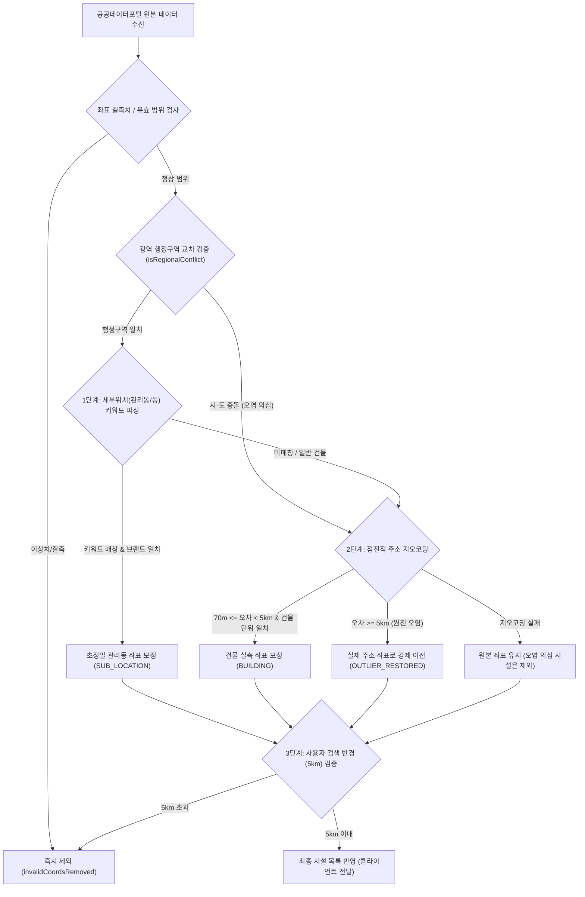

# 📍 위치 보정 및 오염 데이터 정제 시스템 기술 문서

본 문서는 **골든타임 세이프맵(GoldenTime SafeMap)**에서 공공데이터포털의 원천 좌표 오류 및 필지 오차를 해결하기 위해 구축된 **3단계 지능형 위치 보정 및 이상 데이터 정제 파이프라인**의 기술 명세와 동작 원리를 설명합니다.

---

## 🎯 1. 배경 및 해결 과제

1. **지번·필지 대표 좌표 오차**:
   - 공공데이터포털(국립중앙의료원 AED API)에 등록된 좌표 중 상당수는 대단지 아파트의 정문, 단지 중심 지번, 또는 큰 필지 중심에 위치하여 실제 관리사무소나 개별 동 건물과 70m~300m 이상 떨어져 있는 문제가 있었습니다.
2. **원천 데이터의 치명적 오염 (타지역 오기재 사례)**:
   - 데이터 등록 담당자가 주소 지오코딩 시 시·도 접두사를 누락하여 '경기도 여주시 가남읍 양화로 107(여주교도소)'의 좌표를 '서울특별시 마포구 양화로 107(서교동)'으로 등록하는 등 약 65km 이상 떨어진 엉뚱한 타지역 좌표가 원본 DB에 수록되는 사례가 발생했습니다.
3. **마커 겹침으로 인한 장비 선택 불가**:
   - 한 건물이나 관리동에 여러 대의 AED가 동일 좌표로 등록되어 있을 경우, 마커가 완전히 겹쳐져 하위 장비의 정보를 확인하기 어려운 한계가 있었습니다.

---

## 🏗️ 2. 아키텍처 및 3단계 보정 파이프라인

---

## 🔍 3. 세부 구현 알고리즘

### 1단계: 상세위치(buildPlace) 기반 초정밀 보정 (`geocodeSubLocation`)
* **키워드 추출**: `extractSubKeyword(buildPlace)`
  - 정규표현식을 통해 `관리사무소`, `관리실`, `\d+동`, `별관`, `경로당`, `어린이집`, `커뮤니티센터` 등 독립 건물 식별자를 추출합니다.
* **엄격한 브랜드 검증 (`verifyStrictBrandMatch`)**:
  - `효자촌`, `시범`, `샛별` 등 마을 접두사를 제거하고 핵심 브랜드명(`현대`, `한양` 등)이 검색된 장소명에 정확히 포함되어 있는지 검증하여 상가(예: 효자촌프라자)로의 오매칭을 원천 차단합니다.
* **기준 좌표 반경 제한**:
  - 원본 좌표 기준 300m 이내의 결과만 수용하여 단지 밖 동명 시설 매칭을 방지합니다.

### 2단계: 점진적 주소 지오코딩 (`Progressive Geocoding`)
* 세부 건물번호가 카카오 지도에 미등록된 시골 도로/외곽 지역의 지오코딩 실패를 방지하기 위해 3단계 점진적 검색을 수행합니다:
  1. 전체 도로명 및 건물번호: `경기도 여주시 가남읍 양화로 107`
  2. 건물번호 제외 도로명: `경기도 여주시 가남읍 양화로`
  3. 읍·면·동 단위: `경기도 여주시 가남읍`
* 각 결과에는 정밀도(`EXACT` / `ROAD` / `DONG`)가 기록됩니다. 70m~5km 정밀 보정은 `EXACT`일 때만 적용하고, 도로·읍면동 중심점은 5km 이상 원천 오염 복원에만 사용하며 `CHECK_NEEDED`(위치 확인 필요)로 표시합니다.
* 기관명 키워드 검색 결과는 **도로명+건물번호** 또는 **동+지번**이 원본 주소와 정확히 일치하고 시·도가 같을 때만 같은 건물로 인정합니다.

### 3단계: 광역 행정구역 교차 검증 및 원천 오염 좌표 강제 이전
* **광역 행정구역 대조 (`isRegionalConflict`)**:
  - 검색 중심 위치(카카오 `coord2regioncode` 기반)의 시·도와 데이터의 시·도를 대조합니다.
  - 서울 검색 시 인접하지 않은 원거리 시·군(여주, 이천, 안성, 평택 등)이나 타 도(부산, 대구, 광주 등) 데이터는 오염 의심으로 분류합니다.
  - 오염 의심 시설은 원본 좌표 주변 세부위치·키워드 보정을 건너뛰고 텍스트 주소만으로 실제 위치를 검증합니다. 검증된 위치가 반경 안이면 유지(시·도 경계 인근 정상 시설), 검증할 수 없으면 제외합니다.
* **5km 이상 괴리 좌표 강제 이전 (`OUTLIER_RESTORED`)**:
  - 원본 공공데이터 좌표와 실측 주소 좌표 간 편차가 5km 이상일 경우, 공공데이터 원본 좌표를 버리고 실측 주소 좌표로 좌표를 복원합니다.
* **응급 유효 반경 필터 (`MAX_AED_RADIUS_METERS = 5000`)**:
  - 사용자 현재 검색 위치 기준 5,000m를 초과하는 시설은 긴급 탐색 목록에서 안전하게 제외합니다.

---

## 🕷️ 4. 마커 스파이더파이 (Spiderfier) 인터랙션

* **발동 조건**: 20m 이내 반경에 2개 이상의 시설 핀이 밀집되어 있는 경우.
* **시각화**:
  - 원형 클러스터 핀 터치 시 개별 장비들이 방사형 점선 다리(`dashed line`)와 함께 원형으로 펼쳐짐.
* **선택 및 복귀**:
  - 펼쳐진 자식 핀을 터치하면 즉시 하단 카드가 해당 시설 정보로 전환되며 선택 하이라이트 적용.
  - 지도 빈 공간 터치 또는 클러스터 핀 재터치 시 깔끔하게 축소 복귀(`collapseSpider`).

---

## 📊 5. 검증 사례 (Test Cases)

| 검증 시나리오 | 기존 문제점 | 보정 파이프라인 적용 후 결과 |
| :--- | :--- | :--- |
| **서울 마포구 서교동 검색 시** | 여주교도소 AED 5대가 마포구 양화로 107에 오표시됨 | 여주시 실측 좌표로 복원 후 5km 반경 초과로 자동 격리 (`yeojuCountInMapo: 0`) |
| **분당 시범단지한양아파트 검색 시** | 아파트 단지 정문 지번에 핀이 꽂혀 관리사무소 탐색 지연 | `관리사무소 1층 벽면` 인식하여 실제 관리사무소 건물로 298m 초정밀 이전 및 배지 노출 |
| **분당 효자촌현대아파트 검색 시** | 마을 접두사로 인해 인근 '효자촌프라자' 상가로 오매칭 위험 | 브랜드 엄격 검증(`verifyStrictBrandMatch`)으로 오매칭 차단 및 안전한 단지 위치 유지 |
